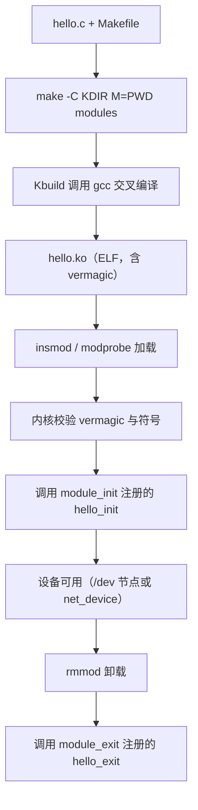

# 嵌入式 Linux 驱动基础：内核模块的组成、编译与加载

> **一句话摘要**：从"驱动是什么"出发，讲清 Linux 内核模块的六个组成部分、out-of-tree 编译方式与 `.ko` 的加载/卸载流程，并给出可直接复用的 Makefile 与 Kconfig 模板。
>
> **适用环境**：ARM64（RK356x 平台实测），Linux 5.x / 6.x，`aarch64-linux-gnu-` 交叉工具链；x86 主机上开发、目标板运行。
> **前置知识**：C 语言指针与编译链接、Linux 命令行、内核源码目录结构。
> **原文来源**：`knowlegdes/driver development/dirver_fudamentals.md`

## 一、背景与原理

### 1.1 要解决的问题

硬件寄存器不会自己工作：CPU 需要通过 load/store 访问映射到物理地址空间的设备寄存器，还要处理中断、DMA 与并发访问。**驱动**就是把这堆硬件细节封装成内核统一接口的那层代码。裸机时代驱动就是一段直接操作寄存器的程序；有了 Linux 之后，驱动必须挂进内核的驱动模型（设备、总线、`file_operations` 等），否则无法被用户空间安全地访问。

把驱动**全部静态编译进内核**会让镜像膨胀、启动变慢，而多数驱动在特定产品上只用一次。**内核模块（`.ko`）** 提供了运行期加载/卸载的能力，这也是本文的主线。

### 1.2 核心概念

| 概念 | 定义 | 关键点 |
| --- | --- | --- |
| 驱动（driver） | 管理某类硬件、向上提供统一接口的内核代码 | 必须遵循内核驱动模型，不能"裸写寄存器了事" |
| 内核模块（module） | 可在运行期加载/卸载的内核代码单元，产物为 `.ko` | 与内核共享地址空间，崩溃即整机崩溃 |
| 字符设备 | 按字节流顺序访问的设备（串口、按键、LED） | 对应 `/dev` 节点 + `file_operations` |
| 块设备 | 以固定大小块随机访问的设备（eMMC、SD、NVMe） | 走块层，有页缓存与 IO 调度 |
| 网络设备 | 面向数据包收发，不对应 `/dev` 节点 | 走 `net_device` + socket 层 |

一个模块由六部分组成，其中 1–3 是**必需**的：

| # | 组成 | 作用 | 是否必需 |
| --- | --- | --- | --- |
| 0 | 头文件 `<linux/module.h>`、`<linux/init.h>` | 提供 `module_init`/`module_exit`/`MODULE_*` 宏 | 必需 |
| 1 | 模块加载函数（入口） | 注册设备、申请资源，返回 0 表示成功 | 必需 |
| 2 | 模块卸载函数（出口） | 释放入口中申请的资源 | 必需 |
| 3 | 许可证声明 `MODULE_LICENSE()` | 声明许可，缺失会导致内核被标记为污染（tainted） | 必需 |
| 4 | 模块参数 `module_param()` | 加载时由用户传入配置（如 `insmod x.ko debug=1`） | 可选 |
| 5 | 导出符号 `EXPORT_SYMBOL*()` | 允许其他模块调用本模块的函数 | 可选 |
| 6 | 作者/描述 `MODULE_AUTHOR()`、`MODULE_DESCRIPTION()` | 元信息，`modinfo` 可读 | 可选 |

### 1.3 工作机制



关键约束：`.ko` 与运行内核的 **vermagic**（内核版本 + 配置指纹 + SMP/预抢占标志）必须一致，否则 `insmod` 直接拒绝。因此"在 A 板编译、拿到 B 板加载"往往失败，必须用目标内核源码树编译。

## 二、代码实现

### 2.1 最小可运行示例

```c
// hello.c —— 最小 out-of-tree 内核模块
#include <linux/init.h>
#include <linux/module.h>
#include <linux/kernel.h>   /* pr_info 定义在 linux/printk.h，kernel.h 已包含 */

/* __init：加载完成后该段内存会被释放，仅用于初始化路径 */
static int __init hello_init(void)
{
	/* 内核态没有 stdio，只能用 printk 家族；pr_info 自动带 KERN_INFO 级别 */
	pr_info("hello: module loaded\n");
	return 0;   /* 返回非 0 会导致 insmod 失败并回滚 */
}

/* __exit：仅对可卸载模块有意义；编译进内核时该函数会被丢弃 */
static void __exit hello_exit(void)
{
	pr_info("hello: module unloaded\n");
}

module_init(hello_init);
module_exit(hello_exit);

MODULE_LICENSE("GPL");           /* 缺失会被标记 tainted，且无法使用 EXPORT_SYMBOL_GPL 符号 */
MODULE_AUTHOR("Figvalar");
MODULE_DESCRIPTION("minimal out-of-tree module");
```

```make
# Makefile —— 注意文件名必须是 Makefile（大小写敏感），GNU make 不会找 MakeFile
# 目标架构与工具链前缀必须与目标内核一致，否则产出的 .ko 架构不对
ARCH ?= arm64
CROSS_COMPILE ?= aarch64-linux-gnu-

obj-m += hello.o        # obj-m：编译为模块；obj-y：编译进内核

# 指向“已经编译过”的目标内核源码树；out-of-tree 构建必需
KDIR ?= /home/topeet/Linux/linux_sdk/kernel
PWD := $(shell pwd)

all:
	# 通过命令行传 ARCH/CROSS_COMPILE，优先级高于环境变量，避免被 shell 里的旧值覆盖
	$(MAKE) -C $(KDIR) M=$(PWD) ARCH=$(ARCH) CROSS_COMPILE=$(CROSS_COMPILE) modules

clean:
	$(MAKE) -C $(KDIR) M=$(PWD) clean

.PHONY: all clean
```

```bash
# 编译：在模块目录执行
make            # 成功后得到 hello.ko

# 加载 / 查看 / 卸载
sudo insmod hello.ko
lsmod | grep hello
dmesg | tail -5            # 看到 "hello: module loaded"
sudo rmmod hello
```

### 2.2 工程化版本

**（1）带模块参数与错误处理**

```c
#include <linux/init.h>
#include <linux/module.h>
#include <linux/kernel.h>

static int debug;
/* 0644：sysfs 中 /sys/module/hello/parameters/debug 的权限 */
module_param(debug, int, 0644);
MODULE_PARM_DESC(debug, "enable debug log (0/1)");

static int __init hello_init(void)
{
	if (debug)
		pr_info("hello: debug enabled\n");
	return 0;
}

static void __exit hello_exit(void)
{
	pr_debug("hello: exit\n");
}

module_init(hello_init);
module_exit(hello_exit);

MODULE_LICENSE("GPL");
```

**（2）用 Kconfig 控制编译方式**

```kconfig
# drivers/hello/Kconfig —— 由上层 Kconfig 以 source 引入
menu "Hello drivers"

config HELLO
	tristate "Hello driver support"      # tristate：y 编进内核 / m 编成模块 / n 不编译
	default m
	help
	  Say M here to build the hello driver as a loadable module.

config HELLO_DEBUG
	bool "Hello debug output"
	depends on HELLO                    # 只有 HELLO 被选中时才可见
	select DEBUG_FS                     # 选中本项时强制打开 DEBUG_FS

endmenu
```

```kconfig
# 顶层 Kconfig 中引入（source 是小写关键字，路径带引号）
source "drivers/hello/Kconfig"
```

引入后，`make menuconfig` 里选中 `<M>`，编译出的 `.config` 会包含 `CONFIG_HELLO=m`，Kbuild 依据它决定把 `hello.o` 编成模块还是静态链入（对应 `drivers/hello/Makefile` 中的 `obj-$(CONFIG_HELLO) += hello.o`）。

## 三、关键点分析

| 问题 | 答案 | 依据/代价 |
| --- | --- | --- |
| 为什么 out-of-tree 必须给 `KDIR`？ | 编模块要复用内核的 `Makefile`、头文件、`Module.symvers` 与配置，必须指向**已编译过**的目标内核树 | 未执行 `make modules_prepare` 时会报 `ERROR: Kernel configuration is invalid` |
| 为什么许可证声明是必需的？ | 缺失时内核被标记为 tainted，且只能使用非 GPL 符号；`EXPORT_SYMBOL_GPL` 导出的符号无法链接 | 见 `Documentation/admin-guide/tainted-kernels.rst` |
| 为什么 `modprobe` 不带 `.ko`？ | `modprobe` 按模块名查 `/lib/modules/$(uname -r)/modules.dep`，`.ko` 由它自己拼；`insmod` 才吃路径 | 带 `.ko` 会报 `FATAL: Module xxx.ko not found` |
| 为什么用命令行传 `ARCH` 而不是 `export`？ | 命令行变量优先级最高，能压过环境里残留的旧值；`export` 在多次切换板卡时容易串味 | `make ARCH=... CROSS_COMPILE=...` |
| 为什么 `.ko` 不能跨内核版本直接用？ | vermagic 校验内核版本、SMP、预抢占与模块版本配置 | 报 `Invalid module format` / `version magic ... should be ...` |
| `__init` / `__exit` 有什么用？ | 加载后释放初始化段，节省常驻内存；`__exit` 在编进内核时被丢弃 | 对内存受限的嵌入式系统有实际收益 |
| 为什么编译进内核而不是模块？ | 启动早期就要用的驱动（存储、console、时钟）不能等用户空间加载 | 代价是镜像变大、无法热替换 |

## 四、避坑指南

1. **现象**：`make` 报 `*** No targets specified and no makefile found. Stop.`
   **根因**：文件命名成了 `MakeFile`（Windows 习惯），GNU make 默认只找 `GNUmakefile`、`makefile`、`Makefile`。
   **修复**：重命名为 `Makefile`。
   **验证**：`ls Makefile && make` 能进入 Kbuild。

2. **现象**：`make` 报 `missing separator` 或 `arch/arm64。` 找不到。
   **根因**：`export ARCH=arm64。` 末尾是中文句号，被当成变量值的一部分。
   **修复**：改成 `export ARCH=arm64`，并统一用命令行参数传入更稳。
   **验证**：`make -pn | grep '^ARCH'` 输出 `ARCH = arm64`。

3. **现象**：`insmod: ERROR: could not insert module hello.ko: Invalid module format`
   **根因**：`.ko` 由另一版本/另一配置的内核树编译，vermagic 不匹配。
   **修复**：用目标板同版本、同配置且已编译的内核树重新 `make`。
   **验证**：`modinfo hello.ko | grep vermagic` 与 `uname -r`、`/proc/version` 对照。

4. **现象**：加载成功但 `dmesg` 出现 `loading out-of-tree module taints kernel`。
   **根因**：模块未声明 GPL 兼容许可证，内核被标记污染（tainted）。
   **修复**：补 `MODULE_LICENSE("GPL")`。
   **验证**：`cat /proc/sys/kernel/tainted` 不再新增对应位。

5. **现象**：`modprobe hello.ko` 报 `FATAL: Module hello.ko not found in directory /lib/modules/...`
   **根因**：`modprobe` 只接受模块名，且要求模块已安装到 `/lib/modules/$(uname -r)` 并执行过 `depmod`。
   **修复**：`modprobe hello`；或开发阶段直接用 `insmod ./hello.ko`。
   **验证**：`modprobe -n -v hello` 打印实际加载路径。

6. **现象**：`make menuconfig` 里找不到自己加的选项。
   **根因**：`source "..."` 写成了 `Source "..."`（Kconfig 关键字大小写敏感），或 `select on B` 这类错误语法导致解析失败。
   **修复**：改为 `source "drivers/hello/Kconfig"`、`select DEBUG_FS`。
   **验证**：`make menuconfig` 后 `/` 搜索 `HELLO` 能定位到条目；`grep CONFIG_HELLO .config`。

7. **现象**：`make` 报 `ERROR: Kernel configuration is invalid. include/generated/autoconf.h or include/config/auto.conf are missing`
   **根因**：`KDIR` 指向的内核树没有配置/编译过。
   **修复**：在该树执行 `make <board>_defconfig && make modules_prepare`。
   **验证**：`ls $KDIR/include/config/auto.conf` 存在。

## 延伸阅读

- 内核源码 `include/linux/module.h`：`module_init`/`module_exit`/`MODULE_*` 宏的真实定义，看清 `__init` 段属性如何生效。
- 内核源码 `kernel/module/main.c`（6.0 起模块加载器拆到 `kernel/module/`）：`load_module` 如何校验 vermagic、解析符号并调用 init。
- 内核源码 `scripts/Makefile.build`：`obj-m`/`obj-y` 如何被 Kbuild 展开成编译与链接命令。
- 内核文档 `Documentation/kbuild/modules.rst`：out-of-tree 模块构建的权威说明（含 `M=` 与 `KDIR` 的语义）。
- 内核文档 `Documentation/kbuild/kconfig-language.rst`：`tristate`、`depends on`、`select` 的准确语义与常见误用。
- 内核文档 `Documentation/admin-guide/tainted-kernels.rst`：taint 标志位含义，排查"为什么内核被污染"。
- 手册页 `man 8 insmod`、`man 8 modprobe`、`man 8 rmmod`、`man 8 modinfo`：kmod 工具族的参数差异。

## 重构记录

| 类型 | 原文 | 修改后 | 理由 |
| --- | --- | --- | --- |
| 结构 | 三段并列：什么是驱动 / 驱动基础 / 编译进内核（末节为空） | 四段式 + 延伸阅读 | 补齐"关键点分析"与"避坑指南"，空节转为可执行内容 |
| 代码 | `#include <linux/module,h>` | `<linux/module.h>` | 逗号笔误，无法编译 |
| 代码 | `export ARCH=arm64。` | `ARCH ?= arm64` + 命令行传入 | 中文句号会污染变量值 |
| 代码 | Makefile 未声明 `.PHONY`、未传 `ARCH/CROSS_COMPILE` | 补全 | 避免伪目标冲突与工具链串味 |
| 命令 | `modprobe mod_name.ko` | `modprobe mod_name` | modprobe 只接受模块名 |
| 命令 | `rmmod mod_name.ko` | `rmmod mod_name` | 同上 |
| Kconfig | `bool"helloworld support"`、`comment"..."` | 关键字与参数间加空格 | Kconfig 语法要求 |
| Kconfig | `select on B` | `select B` | `select` 不带 `on` |
| Kconfig | `Source"init/Kconfig"` | `source "..."` | 关键字小写且需空格 |
| 术语 | 内核被污染（`kerneltainted`） | 内核污染（tainted kernel） | 与内核文档术语一致 |
| 术语 | 块设备"能以任意类型进行访问" | 以固定大小块随机访问 | 块设备的定义是块粒度随机访问 |
| 术语 | "编写一个 `MakeFile`" | `Makefile` | 文件名大小写敏感 |
| 内容 | "将驱动编译进内核"为空 | 补 `obj-y`/Kconfig 选择说明 | 原文缺失章节 |
| 新增 | 无 | `hello.c` 最小模块、Kconfig 片段、7 条避坑 | 原文只有框架描述，缺少可运行代码 |
